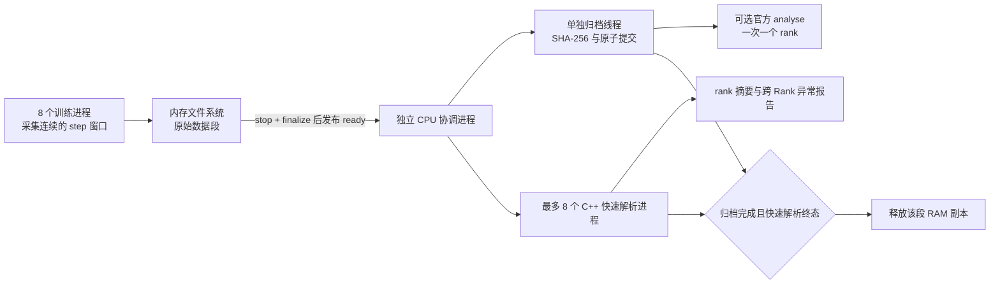

这个旁路采集器把原始 profiling 数据先写入 `/dev/shm`，由独立 CPU 进程持久化并解析。训练进程不调用 `analyse()`，也不等待解析子进程退出。在线模式由最多 8 个 C++ 进程直接扫描原始记录并生成紧凑摘要；MindSpore 官方 `analyse()` 可独立关闭，仅作为离线兼容路径。实现限定于本机 MindSpore 2.4.0、CANN 8.0.RC3、aarch64；包含版本和本机原生库 SHA-256 检查。

磁盘写入、`fsync` 和解析进度不决定下一个训练 step 能否执行，也不决定训练能否退出。C++ 快速解析、Python 调度和磁盘归档彼此分工：C++ 负责定长二进制扫描，Python 只负责进程生命周期和跨 Rank 聚合。保留样本上的 8-rank 窗口 p99 为 0.443 秒，完整 sidecar 调度回放为 1.202 秒，均显著低于约 28.3 秒的训练窗口到达间隔。



这里有一个常驻协调进程、一个归档线程、最多 8 个单 CPU 快速解析进程，以及可选的一个官方解析任务；CANN 官方工具内部还会派生进程。快速解析和归档从同一个已封口、只读的 tmpfs 目录并发读取。所有子进程通过新会话启动并降低优先级，与 MindSpore 的 multiprocessing/atexit 等待机制分离。

交接点是原生 collector 完成写入后，Python 在 tmpfs 原子发布 `ready.json`。这相当于确认“数据已交给共享内存文件”，不确认数据已经持久化。发布后训练不会再修改这段数据，也不会等后台回执；后台保留 RAM 副本到磁盘提交成功后再删除。启动器在训练开始前确认后台已启动，运行中的训练回调不再要求后台心跳正常。后台宕机、心跳超时或写盘失败，都不会直接让训练报错。

仍存在的同步边界是原生 `Profiler.stop()` / `finalize()`：SDK 需要排空采集缓冲并停止本段采集。第一版把其输出指向 RAM，没有修改 SDK 内部的锁、缓冲索引或确认信号。不能把这部分全算成硬件 PMU 开销，也不能宣称“所有非硬件开销已移出训练”。若后续定位到缓冲交接的等待，应在数据已复制或转移所有权后确认释放，而不能在数据尚未接管时伪造完成。

可直接运行当前 20 step 快速验证配置：

```bash
bash /root/work/cyf/pretrain/scripts/run_llama7b_sidecar.sh
```

在线诊断推荐启用快速解析并关闭耗时较长的官方 `analyse()`：

```bash
bash /root/work/cyf/pretrain/scripts/run_llama7b_fastanalyse.sh
```

该新脚本内部传入 `--fast-analyse --no-official-analyse --fast-workers 8 --require-complete-step-trace`。最后一个开关要求每个 Rank 的每个声明 step 都有完整设备 start/end 对，缺任意一对就将快速解析标为失败。`scripts/run_llama7b_sidecar.sh` 保持兼容默认：只运行官方分析。单独使用 `--fast-analyse` 可与官方分析同时开启，用于迁移期双写对照；`--archive-only` 则关闭两种解析。

它使用 `configs/llama2/pretrain_llama2_7b_sidecar_20steps.yaml`：前 2 step 热身，连续采集第 3–20 step；算子和通信开启，内存专项采集关闭，Level0。`sink_size=2` 时框架回调的 step 号是当前两步批次的末尾，因此 `profile_start_step: 4` 对应从实际第 3 step 开始抓取。默认每 100 step 封口一次，训练结束时封口不足 100 step 的最后一段。

默认启用编译缓存，保存到 `/root/work/cyf/pretrain/compile_cache/llama7b/<配置摘要>/`。输出目录和 profile 开关不参与摘要，重复运行可复用同一路径；可用 `--compile-cache-dir` 指定根目录。通过 `--entry` 指定的自定义训练入口会把入口绝对路径、内容摘要以及影响图构建的实验模式写入缓存身份，避免实验入口与默认 `training_entry.py` 互相覆盖依赖哈希。实际是否命中仍以运行日志为准。

指定其他训练配置、输出目录和段长：

```bash
bash /root/work/cyf/pretrain/scripts/run_llama7b_sidecar.sh \
  --config /absolute/path/to/train.yaml \
  --output /root/work/cyf/pretrain/traces/continuous_run_001 \
  --window-steps 100
```

输出目录必须是尚不存在的新目录。段长必须是 `sink_size` 的整数倍。`profile: True`、`profile_rank_ids`、`profile_pipeline`、`profile_communication`、`profiler_level` 仍有效；在这个入口中，`profile_stop_step` 不会关闭采集，由 `--window-steps` 切段并持续到训练结束。训练本身是否停止仍由训练配置决定，快速验证配置的 `TrainCallBack.stop_step: 20` 需要在长训配置中去掉或调整。数据集、epoch、checkpoint 的正常训练逻辑不由采集器改写。

`init_start_profile: False` 时，sidecar 仍会在图编译前创建 inactive Profiler，使图包含设备逐-step trace 点；到 `profile_start_step` 才调用 `start()`，因此编译和前两步热身不会写入采集段。不能把整个 Profiler 对象延迟到热身后才创建，否则已经编好的图没有 `60000/60001` step marker。编译缓存摘要包含 `sidecar_graph_instrumentation=profiler_preinit_step_trace_v1`，会自动避开旧版未插桩图。

要从初始化起抓取所有训练 step，可设 `init_start_profile: True`，但编译也会进入 trace，数据量和解析时间可能非常大。热身后的持续采集能避免这个一次性成本。`profile_memory: True` 要求从初始化开始启用；在模型内存已分配后才开始内存采集会缺少指针的来源信息。Python 堆栈不在默认低开销配置中。

查看实际进程状态、覆盖范围和解析情况：

```bash
python /root/work/cyf/pretrain/profiler_sidecar/inspect_run.py /absolute/run/output

# 全部结束后，校验每个原始文件的 SHA-256，并验证没有漏 step、重复 step 或缺 rank。
python /root/work/cyf/pretrain/profiler_sidecar/inspect_run.py /absolute/run/output \
  --verify --first-step 3 --last-step 20 --ranks 8 --save
```

`training_run.json` 记录训练启动器完整退出耗时；`status.json` 记录采集缓冲占用、两种解析积压、快速解析/窗口成功失败计数和真实进程身份（namespace PID、`/proc` PID 与 Linux 启动时钟，防止 PID 复用）。`segments/segment_N/rank_R/ready.json` 记录全局 step 区间和本段启动、停止、finalize、元数据准备耗时及交接时间。`archive.json` 记录原始文件大小、摘要以及复制和文件 fsync 耗时。

快速结果写在 `fast/segment_N/`：`rank_R.json` 为 kernel/step/HCCL 紧凑摘要，`rank_R.result.json` 为进程结果，`window_summary.json` 为跨 Rank 对比。逐 Rank 每步耗时在 `rank_R.json` 的 `steps[].duration_ns`；集中查看所有 Rank 时使用 `window_summary.json` 的 `step_comparisons[].per_rank_ns`。`global_step` 是训练实际 step；延迟启动采集后设备原始 `index_id` 可能从 1 重新计数，因此只作为原始诊断字段保留。原始 `profiler/` 保留不变。若启用官方分析，它仍在单独的 `analysis/` 副本中执行，`parse_result.json` 分别记录输入复制、框架初始化、analyse、输出校验和临时副本清理耗时。后台会在训练退出且所有已封口段处理完后自行退出。

### 前三类在线诊断（实验模式）

同角色 rank 组必须显式指定。当前 8 卡纯 DP 配置可运行：

```bash
bash /root/work/cyf/pretrain/scripts/run_llama7b_fastanalyse.sh \
  --output /root/work/cyf/pretrain/profiler_sidecar/runs/new_online_run \
  --training-stop-step 40 --window-steps 6 --disable-checkpoint \
  --online-diagnosis --diagnosis-peer-groups 0,1,2,3,4,5,6,7
```

`--online-diagnosis` 要求同时启用 `--fast-analyse` 与 `--require-complete-step-trace`；推荐脚本已提供这两个开关。`sink_size=2` 时，训练 callback 每两步记录一次主机 sink 批次时长、完成 step 和 profiler 边界标记。训练线程只向有界队列投递，独立线程写 `/dev/shm/.../metrics/rank_R.jsonl`；每 5 秒发送包含最近完成 step、队列深度、观察到的峰值深度和丢弃计数的心跳，不增加设备同步。队列满或写入失败不会等待后台。callback 时间戳在 profiler 启动之后、封段停止之前，相关同步边界耗时仍单独保留在 `ready.json`。首个包含编译/热身的 sink 批次不进入历史基线；其他窗口边界批次保留标记并参与基线。

sidecar 增量消费上述指标，并在快速窗口 `window_result.json` 成功后处理设备逐实际 step 耗时。两种指标分别维护历史基线，不混算。结果原子写入 `diagnosis/sinks/step_N/`、`diagnosis/windows/segment_N.json` 和 `diagnosis/progress/`；数据缺失、窗口失败、队列丢弃及进度组超时写入 `diagnosis/quality/`。`diagnosis/state.json` 保存消费游标和有限长度历史，进程重启后从未处理处继续，结果路径稳定以避免重复发布。运行结束后，小型 telemetry JSONL 复制到 `diagnosis/telemetry/` 供复核。

当前阈值为实验值：主机和设备时长相对增加 10% 且绝对增加至少 250 ms，单 rank 历史尖峰还要求稳健 z 分数至少为 5。主机批次信号最快在一个 sink 结束后产生，设备 step 信号在 6-step 窗口封口和快速汇总后产生。进度落后告警需要同角色组有成员领先至少一个 sink 且该 rank 30 秒未完成新 sink；它是症状候选，不是慢卡根因定位。后台诊断失败记录在 `status.json` 的 `diagnosis_failed` 和 `diagnosis/failure.json`，训练不会等待诊断结果。默认关闭此实验模式，原有快速解析/归档行为不变。

40-step 运行结束后，可用 `python3 profiler_sidecar/report_online_run.py <运行目录>` 检查 sink、窗口、设备 rank-step 和遥测覆盖，并在 `ONLINE_REPORT.json` 查看主机事件到结果、窗口汇总完成到诊断的实测时间。流式异常注入脚本位于 `profiler_sidecar/research/evaluate_online_diagnosis.py`；其延迟只代表 CPU 回放处理，不包含真实训练等待下一个 sink 或窗口的时间。

### 在线可视化 Demo

`dashboard_server.py` 只读取 sidecar 已原子发布的 `fast/`、`diagnosis/` 和 `status.json`，不进入训练进程，也不读取未封口的原始 Trace。页面每 2 秒刷新，当前展示设备逐 Step 的 8 卡平均/最大/范围、Rank×Step 热力图、主机 sink 批次趋势、Rank 进度、旁路健康以及告警和数据质量时间线。设备图随快速窗口封口更新；主机图随每个 sink 结果更新。首个 Step 1–2 sink 的回调区间包含首次图编译，只保留在 `host_warmup_batches` 和诊断原始文件中，不绘入稳态主机耗时曲线。两张趋势图的橙色虚线是最近最多 12 个有效点的滚动中位基线，红色点虚线是 `max(基线×1.10, 基线+250ms)` 参考阈值；越过红线本身不等于最终告警，诊断还会检查稳健 z 分数、持续性或同伴偏离。

`scripts/run_llama7b_fastanalyse.sh` 默认在训练进程启动前为本次输出目录启动一个独立仪表盘。端口从 18736～18835 中选择尚未占用的值，因此仍在运行的历史页面不会被新实验替换。终端会打印平台代理 URL 和可点击链接，运行目录同时保存 `dashboard.json`、`DASHBOARD_URL.txt` 和 `dashboard.log`。远端训练进程不能绕过浏览器的用户交互限制强制打开本地标签页；点击终端链接即可进入页面。需要关闭自动启动时传 `--no-dashboard`，需要固定端口时传 `--dashboard-port PORT`。

训练结束后仪表盘服务继续运行以保留在线页面；sidecar 完成全部归档和快速解析后，会原子生成运行目录下的 `DASHBOARD.html` 离线快照。即使服务后来退出，快照仍可通过 Jupyter 文件入口打开。

需要演示真实分布式等待的测试运行，可以同时传入 `--test-host-delay-rank R --test-host-delay-step S --test-host-delay-seconds T`。三项必须同时提供，要求在线诊断已开启、`S` 对齐 `sink_size` 且不超过停止 step、`T` 在 `(0, 60]`。指定 Rank 会在以 `S` 结尾的 sink 已完成设备执行后，于 `step_end` 主机回调中暂停一次；暂停计入该主机 sink 时长，不计入设备 Step `S` 的 trace，后续 Rank 可能在下一批集合通信处出现连锁等待。遥测、诊断文件和仪表盘会保留 `test_injected_delay_seconds` 标记，主机图用红点显示测试注入。常规运行不传这些参数。

```bash
cd /root/work/cyf/pretrain/profiler_sidecar
python3 dashboard_server.py /path/to/run --bind 0.0.0.0 --port 18736
```

也可以把一次运行导出为不需要服务端的单文件快照：

```bash
python3 dashboard_server.py /path/to/run --export-html /path/to/DASHBOARD_DEMO.html
```

页面及数据接口不依赖第三方 Python 或前端包。当前版本是交互方案 Demo，尚未加入长期降采样、多次运行对比、用户配置的阈值以及 Kernel/HCCL 详情钻取。

手工驱动的 Cell 等合法场景可能没有 `ts_track`。快速摘要会明确区分 `ts_track_available`、`step_trace_available` 和 `step_trace_complete`，没有 marker 时保留空的 `steps`，但仍生成 device task、kernel 和 HCCL 统计。默认兼容模式允许这种降级；在线逐-step 诊断应使用 `--require-complete-step-trace` 失败闭合。有文件但没有 marker 不再误报为 step trace 可用；记录长度损坏同样失败闭合。

后台故障后，确认旧进程已退出，可用以下命令恢复归档和解析。文件锁会拒绝同一运行的第二个协调进程，恢复时不会重复启动仍存活的解析任务：

```bash
source /usr/local/Ascend/ascend-toolkit/set_env.sh
# RAM_ROOT 取自输出目录内 sidecar_config.json 的 ram_root 字段。
nohup python /root/work/cyf/pretrain/profiler_sidecar/worker.py run /dev/shm/cyf-profile/RUN_ID \
  > /absolute/run/output/sidecar_resume.log 2>&1 < /dev/null &
```

某段解析失败后可单独重试。它读取完整原始归档重新创建解析副本：

```bash
python /root/work/cyf/pretrain/profiler_sidecar/worker.py parse \
  /absolute/run/output/segments/segment_000001/rank_0 \
  --config /absolute/run/output/sidecar_config.json
```

默认 RAM 积压阈值为 64 GiB，tmpfs 保留至少 8 GiB 空闲，磁盘保留至少 32 GiB 空闲；可用 `--max-ram-gib`、`--min-ram-free-gib`、`--min-disk-free-gib` 调整。阈值在 step 回调处检查，不是每一次 CANN 内部写入的硬配额，因此单个采集窗口也必须能放进 RAM。后台停滞时，用最近一次报告的原始数据量加上 tmpfs 用量增长估算积压；其他作业使用同一 tmpfs 可能使该软阈值提前触发，独立的剩余空间检查始终有效。

达到 RAM 阈值后，仅停止新增 profiling，封口并保留已有数据，训练继续。中断原因和最后采集 step 写入 `clients/rank_N.json`，归档端汇总为 `capture_interruptions` 并将最终结果标记为 `incomplete`；不会把有缺口的采集误报成全量连续采集。当前不会自动恢复因容量而停止的采集。归档失败时 RAM 原件保留，训练继续使用剩余缓冲。快速解析失败时，先等待归档成功，再写入 failed 结果并释放 RAM；因此磁盘原档可重试但 tmpfs 不会永久泄漏。官方解析失败同样不删除原始归档。这是有限容量下优先保证训练继续的策略，不承诺磁盘永久阻塞时仍能无限保留所有数据。

官方解析吞吐低于采集吞吐时，其磁盘队列仍会增长；因此在线场景推荐 `--fast-analyse --no-official-analyse`。快速解析在现有 40 段上达到 18.80 rank-segment/s，8-rank 窗口 p99 约 0.443 秒。归档 40 段累计 80.43 秒，低于对应 141.5 秒的窗口到达预算，但出现过 44.46 秒的单窗口存储长尾，tmpfs 缓冲仍不可取消。此实现不自动删除已归档的历史 trace，也不默默丢弃窗口；长期保留策略需要按磁盘容量另行设置。

仍留在训练进程里的成本包括采集钩子、原始事件编码、写 tmpfs、窗口边界的 NPU 同步与原生 collector 的 stop/finalize。切段期间不提交新的训练 step，因此开始采集后的 step 区间连续，但窗口间墙钟时间有采集空隙。100 step 一段通常比每 4 step 一段更适合长训，实际开销应以模型实测为准。这里没有承诺零开销，也没有把编译耗时差异当作 profiler 的收益。

MindSpore 2.4 的原生 dumper 在 stop 后会保留旧文件句柄，导致删除后的 tmpfs 文件仍可能占用内存。`native.py` 在原生 collector 完全停止后，通过本机导出的 C++ 符号调用 `ProfilingDataDumper::UnInit()` 关闭句柄；下一段启动会重新 Init。此处是本实现的私有接口修改点，已用真实 NPU 多次切段测试。升级 MindSpore 必须重新验证原生 ABI，不能只绕过版本/摘要检查。

Level0 在当前 CANN/MindSpore 组合上可能不生成 op_statistics，MindSpore 会在生成 timeline 后跳过部分汇总；这种结果标记为 `timeline_only`。Level1 小模型验证能生成标准 `trace_view.json` 和算子统计。解析的返回码本身不足以判断结果成功，本实现还流式验证 JSON 完整性和 duration 事件。内存、堆栈等专项数据的完整性需要对应场景验证。

参考：[MindSpore 2.4 Profiler / offline_analyse API](https://www.mindspore.cn/docs/zh-CN/r2.4.0/api_python/mindspore/mindspore.Profiler.html)。本机版本的具体行为还通过已安装 Python 源码、导出符号和 NPU 运行确认；`research/native_build.json` 保存了原生库指纹。测试代码在 `tests/`，实测原始输出保留在 `runs/`，不要将失败开发试跑与完成的验证混为一谈。

功能解耦回归测试：

```bash
python -m unittest discover -s /root/work/cyf/pretrain/profiler_sidecar/tests -p 'test_*.py' -v
source /usr/local/Ascend/ascend-toolkit/set_env.sh
/root/miniconda3/envs/mindspore2.4_python3.10/bin/python \
  /root/work/cyf/pretrain/profiler_sidecar/tests/verify_decoupling.py \
  --output /absolute/new/test/output
```

上面的 `verify_decoupling.py` 使用真实 2 卡 MatMul + AllReduce：暂停后台协调进程并注入过期心跳/写盘错误，要求训练在恢复后台之前完成；随后暂停解析进程，要求归档仍能排空 RAM；最后验证原始文件 SHA-256 和完整分段覆盖。另一次运行模拟 RAM 阈值触发，要求训练跑满 6 step，而采集中断必须被明确报告。这两个 case 是功能与故障隔离验证，不用于推算 Llama7B 的性能开销。

快速解析在线 smoke 使用 `tests/fast_online_smoke.yaml`。本机已验证 2 Rank × 3 窗口全部完成、归档校验无误且 tmpfs 排空；对应输出为 `runs/fast_online_smoke_20261020c`。与 archive-only 对照的训练循环总时长差异为 +0.22%，单次小样本只能用于排除明显回归。

8 卡 Llama2-7B 的 40-step、6-step 窗口训练开销实验见 `runs/overhead_8card_40step_6window_20261021b/OVERHEAD_REPORT.md`。四对命中编译缓存的 A/B 中，快速解析相对纯归档的平均增量为 +0.34%，近似 95% 配对 t 区间为 −0.22%～+0.89%，尚不能判定稳定减速。完整快速方案相对无 profiling 的组中位数差为 +0.97%，但基线存在运行间漂移；仅适用于本次目标负载和采集配置。

在线诊断的 8 卡 40-step 验收见 `runs/online_diagnosis_8card_40step_6window_20261021e/ONLINE_REPORT.json` 与 `fastanalyse/RESULTS.md` 的在线化一节。最终轮 160 个 Rank sink、20 个同组批次、7 个窗口及 304 个设备 rank-step 完整，0 发现、0 质量问题、0 遥测丢弃；队列最大观察深度为 1。主机事件到结果 p95 为 604 ms，最后一个 Rank 封段到设备诊断 p95 为 2.37 s。相邻快速解析对照与两次在线轮的稳态差异为 −0.67%、−0.30%；样本量不足以认定稳定开销或收益。真实摘要注入检出记录位于 `runs/online_diagnosis_stream_eval_20261021c/evaluation.json`。
